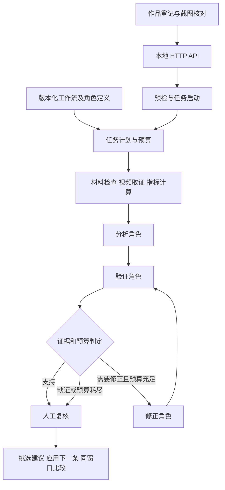

# 短视频复盘平台架构与参赛边界

本平台面向教程讲解类短视频，以实际视频、字幕和经人工核对的平台数据为证据，生成下一条创作建议。实现采用本地 Python 服务和原生网页。本文描述已实现结构，不能代替真实评测报告。

## 架构

## 定义与运行

`workflows/tutorial-review.json` 定义角色、工具白名单、提示词绑定、阶段输入输出、依赖和反馈轮数上限。`workflow_definition.py` 在调用模型之前检查定义；`workflow_plan.py` 将完整定义、版本及指纹写入计划。三个模型角色分别使用分析、验证和修正提示词；角色可以使用同一个模型，不意味着统计独立。

当前执行器支持五个已注册阶段的依赖图、数据缺失分支、任务优先级和角色容量约束。`workflow_scheduler.py` 根据依赖是否完成动态派发就绪任务；默认最多两个线程，视频取证与指标计算可并行，分析等待两者完成。相同角色最多同时执行一项，工具失败后不派发新任务，已启动工具完成后收敛退出。状态落盘使用进程内锁避免并发覆盖。

模板可调整任务顺序、优先级、线程上限和额外依赖，但不能移除必需依赖或形成环。可调整显示名称、版本及反馈轮数上限；新增工具仍需注册实现。当前没有子工作流嵌套、动态角色发现或模型自主规划能力，不应描述为完整通用编排平台。

每次运行保存模板及提示词指纹；阶段启动前发现配置变化会停止，避免同一轮混用配置。每个模型阶段继续保存实际请求提示词、原始输出和证据来源。已有历史记录兼容读取，不回填新字段。

## 验证驱动调度

`feedback_policy.py` 根据验证模型的结构化反馈、已执行轮数和剩余预算选择路径。缺证优先停止；全部支持则交人工；可修正时只指向需修改的条目，保留已支持条目；每轮预留修正与再次验证两次调用。空反馈或未知状态不能当作通过。

`refinement.py` 执行选择的路径，每次写入 `feedback_routed` 事件，包含状态计数、原因、剩余预算、选定角色及修正对象。调度不额外调用模型，判断依赖验证模型反馈，控制层使用明确约束。循环须在运行预算中启用；未启用时保持分析和验证后交人工。

网络故障重试与语义修正是两种机制：前者解决调用失败，后者根据证据反馈修改内容；两者均计入预算。缺证不通过重复生成来解决。

## 数据与日志

样本与经确认的截图记录绑定；一轮输入被冻结，历史复盘不随新数据改写。结果存于 `reports/workflows/<run>/`，包括 `plan.json`、`workflow.json`、`events.jsonl` 和阶段输出。HTTP 请求日志位于 `reports/review-server/`，已有轮转与脱敏。真实素材、运行记录和本地配置由 Git 忽略。

## 参赛验收与尚缺能力

已有基础：真实创作场景、三个模型角色、工具取证、条件分支、受控修正循环、人工介入、运行留档和下一条创作比较。

仍需完成：用真实案例验证循环质量；用固定样本和人工标注比较单次分析与分析加验证修正的可靠性、调用数和耗时；干净环境复现；方案书、PPT 和演示视频。当前未实现动态角色发现、知识库检索及记忆管理，不能宣称已完整满足全部平台级能力。应逐条对照赛题要求继续验收。

自动化合成测试证明程序分支和数据约束有效，不证明模型建议正确，也不证明播放或点赞提升。
